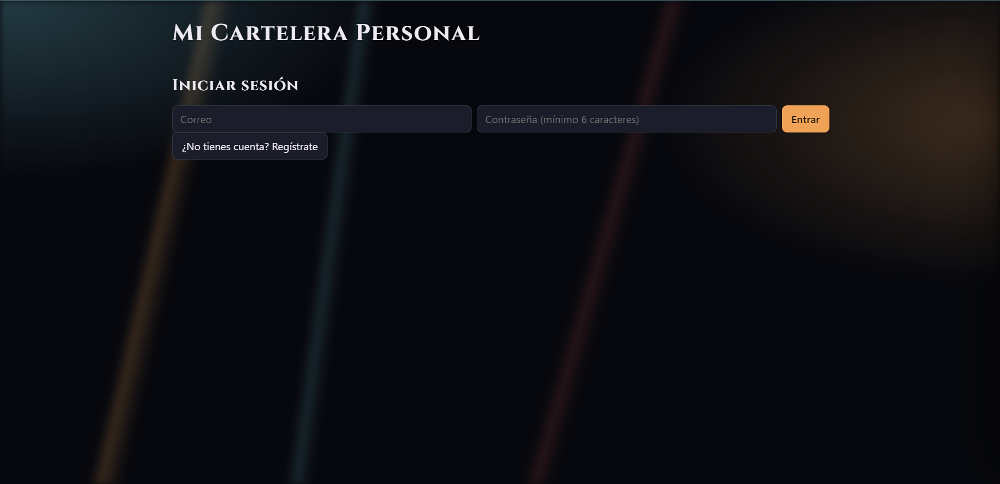
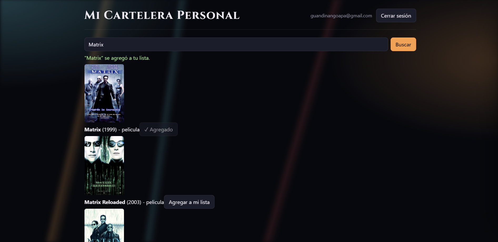
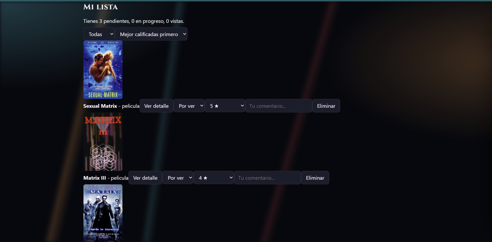
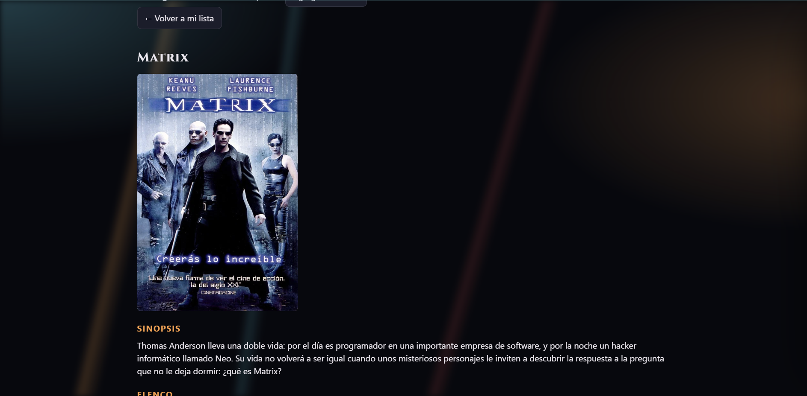

# Mi Cartelera Personal

Aplicación web donde cada usuario registra, organiza y califica las películas y series que quiere ver, está viendo o ya vio. Busca títulos reales en la API de TMDB y guarda su propia versión (estado, calificación y comentario) en una base de datos de Supabase protegida con autenticación y Row Level Security.

## Tecnologías

- React + TypeScript (Vite)
- TMDB API (búsqueda, pósters, sinopsis y elenco)
- Supabase Auth (registro, login y logout)
- Supabase PostgreSQL con políticas RLS

## Funcionalidades

- Acceso controlado: sin sesión iniciada no se ve ninguna pantalla de contenido
- Búsqueda en TMDB con estados de carga y error
- Agregar títulos a mi lista (sin duplicados)
- Cambiar estado (por ver, viendo, vista), calificación de 1 a 5 y comentario
- Eliminar títulos de la colección
- Página de detalle con póster, sinopsis, elenco y calificación oficial
- Cada usuario solo ve y modifica sus propios títulos (RLS)

## Instalación

1. Clona el repositorio e instala las dependencias:

```bash
git clone https://github.com/ApaukiG/mi-cartelera.git
cd mi-cartelera
npm install
```

2. Crea un archivo `.env` en la raíz con estas variables:

```
VITE_SUPABASE_URL=tu_url_de_supabase
VITE_SUPABASE_ANON_KEY=tu_clave_anon_de_supabase
VITE_TMDB_API_KEY=tu_api_key_de_tmdb
```

3. En el SQL Editor de Supabase crea la tabla `mi_lista` con sus políticas RLS (ver la sección siguiente).

4. Inicia la app:

```bash
npm run dev
```

## Base de datos

```sql
create table mi_lista (
  id bigint generated always as identity primary key,
  user_id uuid not null default auth.uid() references auth.users(id) on delete cascade,
  tmdb_id integer not null,
  titulo text not null,
  poster_url text,
  tipo_contenido text not null check (tipo_contenido in ('pelicula','serie')),
  estado text not null default 'por_ver' check (estado in ('por_ver','viendo','vista')),
  calificacion_personal integer check (calificacion_personal between 1 and 5),
  comentario text,
  fecha_agregado timestamptz not null default now(),
  constraint mi_lista_unico_por_usuario unique (user_id, tmdb_id, tipo_contenido)
);

alter table mi_lista enable row level security;

create policy "ver solo lo mio" on mi_lista
  for select to authenticated using (auth.uid() = user_id);
create policy "insertar solo lo mio" on mi_lista
  for insert to authenticated with check (auth.uid() = user_id);
create policy "editar solo lo mio" on mi_lista
  for update to authenticated
  using (auth.uid() = user_id) with check (auth.uid() = user_id);
create policy "borrar solo lo mio" on mi_lista
  for delete to authenticated using (auth.uid() = user_id);
```

## Capturas de pantalla

## Capturas de pantalla

### Inicio de sesión


### Buscador de TMDB


### Mi lista


### Detalle de un título
