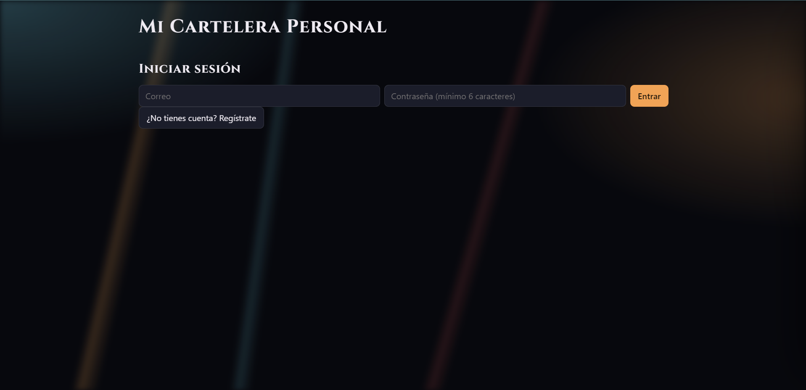
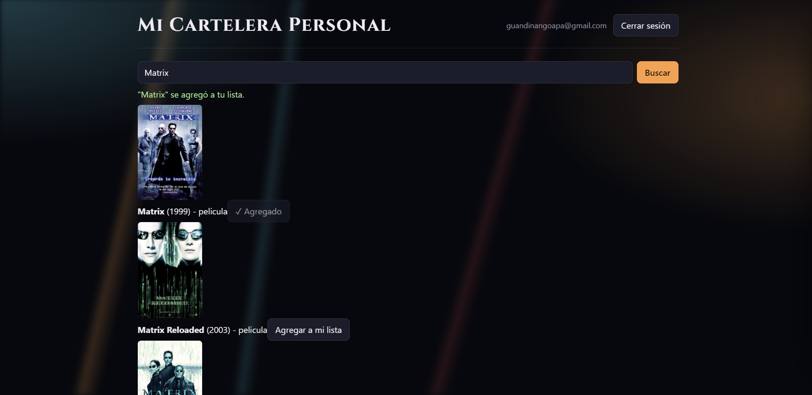
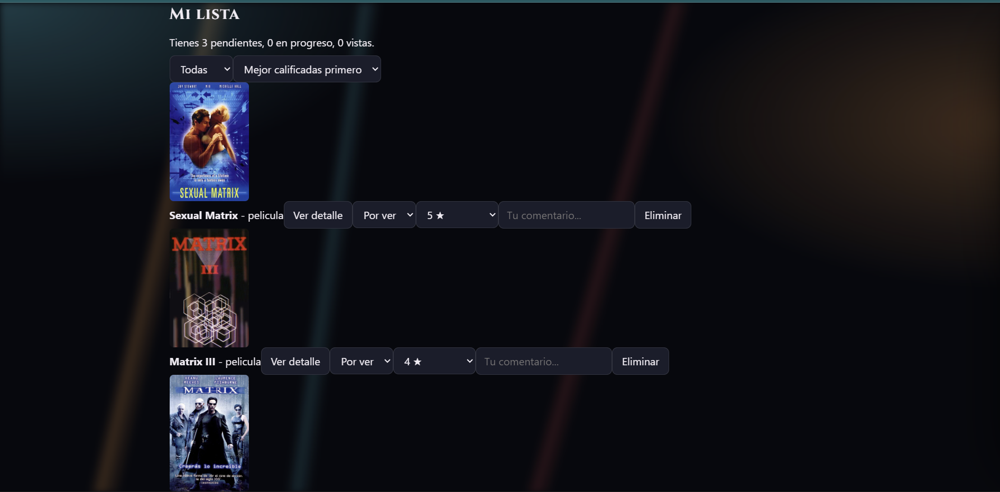
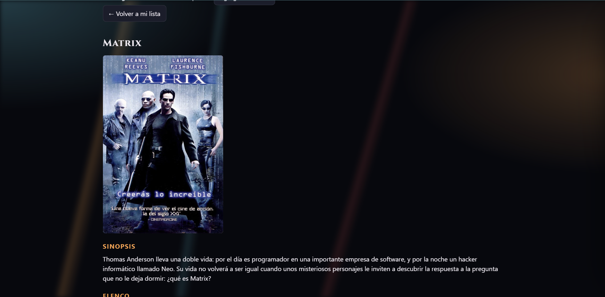

# Mi Cartelera Personal

Aplicación web donde cada usuario registra, organiza y califica las películas y series que quiere ver, está viendo o ya vio. Busca títulos reales en la API de TMDB y guarda su propia versión (estado, calificación y comentario) en una base de datos de Supabase protegida con autenticación y Row Level Security.

**App publicada:** https://mi-cartelera-zeta.vercel.app

## Tecnologías

- React + TypeScript (Vite)
- TMDB API (búsqueda, pósters, sinopsis, elenco y duración)
- Supabase Auth (registro, login y logout)
- Supabase PostgreSQL con políticas RLS
- Vitest para los tests de la lógica de negocio
- CSS propio documentado en `DESIGN.md` (sin librerías de UI)

## Funcionalidades

### Épica E1 — Mi lista

- Acceso controlado: sin sesión iniciada no se ve ninguna pantalla de contenido
- Búsqueda en TMDB con estados de carga y error
- Agregar títulos a mi lista (sin duplicados)
- Cambiar estado (por ver, viendo, vista), calificación de 1 a 5 y comentario
- Eliminar títulos de la colección
- Página de detalle con póster, sinopsis, elenco y calificación oficial
- Cada usuario solo ve y modifica sus propios títulos (RLS)

### Épica E2 — Noche de película

Una segunda vista, a la que se llega con el botón **"Noche de película"** de la cabecera, para planear qué ver con el tiempo que tienes:

- Indicas cuántos minutos tienes (un entero entre 30 y 600) y la app te muestra qué películas «por ver» de tu lista caben, de la más corta a la más larga. Las duraciones se piden a TMDB.
- Las que no caben, o no tienen duración conocida, aparecen aparte y con el motivo.
- Armas una sesión con varias películas. Entre una y otra se cuenta una pausa de 10 minutos, y la app te muestra el total y el tiempo que te queda. Si cambias el tiempo y la sesión ya no cabe, te avisa.
- Guardas la sesión con un nombre (máximo 60 caracteres). Las sesiones guardadas se pueden consultar y eliminar, pero no editar.
- Las sesiones guardan su propia copia de las películas: borrar o marcar como vista una película en Mi lista no las cambia.
- Cada usuario solo ve sus sesiones (RLS en las tablas `sesiones` y `sesion_peliculas`).

Cómo funciona por dentro:

- La lógica de negocio (validar el tiempo, sumar duraciones y pausas, decidir qué cabe, ordenar y validar el nombre) son funciones puras en `src/dominio/`, sin red, y tienen tests.
- Los componentes de `src/components/noche/` no llaman a Supabase ni a TMDB directamente: lo hacen a través de los servicios de `src/lib/` (`tmdb.ts`, `sesiones.ts` y `lista.ts`).
- Al guardar, la sesión y sus películas se escriben en una sola transacción, mediante la función `crear_sesion` de PostgreSQL.

## Instalación

1. Clona el repositorio e instala las dependencias:

```bash
git clone https://github.com/ApaukiG/mi-cartelera.git
cd mi-cartelera
npm install
```

2. Crea un archivo `.env.local` en la raíz con estas variables. Este archivo está en `.gitignore`: no lo subas al repositorio ni copies las claves en ningún otro sitio.

```
VITE_SUPABASE_URL=tu_url_de_supabase
VITE_SUPABASE_ANON_KEY=tu_clave_anon_de_supabase
VITE_TMDB_API_KEY=tu_api_key_de_tmdb
```

3. En el SQL Editor de Supabase:
   - crea la tabla `mi_lista` con sus políticas RLS (ver la sección "Base de datos");
   - ejecuta la migración de la E2, `supabase/migrations/20261110224632_sesiones.sql`, que crea las tablas `sesiones` y `sesion_peliculas` con RLS y la función `crear_sesion`.

4. Inicia la app:

```bash
npm run dev
```

## Comandos y tests

| Comando         | Qué hace                                                         |
| --------------- | ---------------------------------------------------------------- |
| `npm run dev`   | Servidor local de Vite                                           |
| `npm test`      | Ejecuta una vez los tests de Vitest (`vitest run`)               |
| `npm run lint`  | ESLint                                                           |
| `npm run build` | Comprueba los tipos con TypeScript (`tsc -b`) y compila con Vite |

Los tests están junto al código que prueban:

- `src/dominio/*.test.ts`: tiempo y pausas (`sesion`), qué cabe y en qué orden (`candidatas`), nombre de la sesión (`nombre`) y duración de TMDB (`duracion`).
- `src/lib/*.test.ts`: las funciones puras de los servicios (`sesiones`) y `tmdb`, con `fetch` simulado. No hacen peticiones reales.

Para dejar Vitest vigilando los cambios, usa `npx vitest`. La verificación manual en el navegador, la que no cubren los tests, está en `docs/VERIFICACION.md`.

## Cómo está armado el harness

El proyecto se desarrolla con un agente de IA (Claude Code). Estos archivos le marcan las reglas de trabajo:

- **`AGENTS.md`**: las reglas del proyecto. Incluye el stack, los comandos y las reglas de trabajo: no escribir código sin una spec en `docs/specs/`, un commit por ticket, no reescribir la E1, lógica pura en `src/dominio/` con tests, componentes sin llamadas directas a Supabase ni a TMDB, nada de `any` y estilos según `DESIGN.md`. También tiene las reglas de claves: solo en `.env.local` y nunca en el código, los commits ni la terminal.
- **`CLAUDE.md`**: lo que lee Claude Code al empezar. Solo remite a `AGENTS.md` (`@AGENTS.md`), así que las reglas viven en un único sitio.
- **Skill `/commit`** (`.claude/skills/commit/SKILL.md`): crea un commit siguiendo las reglas. Revisa el diff, comprueba que no haya claves ni archivos `.env*`, agrega solo los archivos relacionados y escribe el mensaje en español con el formato `tipo(alcance): descripción`, con el id del ticket al principio si lo hay (`[E2-T03] feat(dominio): …`). Solo se ejecuta cuando la persona escribe `/commit`, y nunca hace `push`.
- **Hook de Prettier** (`.claude/settings.json` → `.claude/hooks/format.mjs`): un hook `PostToolUse` que, cada vez que el agente crea o edita un archivo (`Edit`, `Write` o `MultiEdit`), ejecuta `npx prettier --write` sobre ese archivo con la configuración de `.prettierrc` (comillas simples y sin punto y coma). Si Prettier falla, no bloquea al agente.

## Documentación (`docs/`)

Conviene leer los documentos en este orden, que es también el orden en que se escribieron:

1. `docs/ESTADO-INICIAL.md`: qué hacía la app al terminar la E1, con sus deudas (D-01 a D-27) y sus decisiones.
2. `DESIGN.md` (en la raíz) y `docs/diseno/brand-board.html`: sistema de diseño, con tokens, componentes y los criterios DIS-01 a DIS-15.
3. `docs/prd/PRD.md`: el producto, con las épicas E1 y E2, las reglas RN-01 a RN-15 y los supuestos SU-01 a SU-07.
4. `docs/backlog/historias.md`: historias HU-01 a HU-06 con sus criterios de aceptación.
5. `docs/backlog/refinamiento.md`: casos borde CB-01 a CB-21.
6. `docs/backlog/tickets.md`: tickets E2-T00 a E2-T14 y su orden.
7. `docs/specs/noche-de-pelicula.md`: spec técnica de la E2, con el modelo de datos, el dominio, los servicios, la interfaz, los criterios S-01 a S-22 y cómo se verifica cada criterio.
8. `docs/VERIFICACION.md`: resultado de la verificación de cada criterio y salida de `npm test`, `lint` y `build`.
9. `docs/AUDITORIA.md`: estado y evidencia de cada criterio, y los hallazgos pendientes.

## Base de datos

### Épica E1 — `mi_lista`

```sql
create table mi_lista (
  id bigint generated always as identity primary key,
  user_id uuid not null default auth.uid() references auth.users(id) on delete cascade,
  tmdb_id integer not null,
  titulo text not null,
  poster_url text,
  tipo_contenido text not null check (tipo_contenido in ('pelicula','serie')),
  estado text not null default 'por_ver' check (estado in ('por_ver','viendo','vista')),
  calificacion_personal integer check (calificacion_personal between 1 and 5),
  comentario text,
  fecha_agregado timestamptz not null default now(),
  constraint mi_lista_unico_por_usuario unique (user_id, tmdb_id, tipo_contenido)
);

alter table mi_lista enable row level security;

create policy "ver solo lo mio" on mi_lista
  for select to authenticated using (auth.uid() = user_id);
create policy "insertar solo lo mio" on mi_lista
  for insert to authenticated with check (auth.uid() = user_id);
create policy "editar solo lo mio" on mi_lista
  for update to authenticated
  using (auth.uid() = user_id) with check (auth.uid() = user_id);
create policy "borrar solo lo mio" on mi_lista
  for delete to authenticated using (auth.uid() = user_id);
```

### Épica E2 — `sesiones` y `sesion_peliculas`

Todo está en `supabase/migrations/20261110224632_sesiones.sql`:

- **Tablas:** `sesiones` (nombre, tiempo disponible, tiempo total y fecha) y `sesion_peliculas` (copia del título y la duración, con su posición).
- **RLS:** en las dos tablas, cada usuario solo lee, crea y borra lo suyo.
- **Sin edición:** no hay política ni privilegio de `update`, porque las sesiones no se editan.
- **Función `crear_sesion`:** guarda la sesión y sus películas en una sola transacción.

El detalle está en la spec, §2.

## Capturas de pantalla

### Inicio de sesión



### Buscador de TMDB



### Mi lista



### Detalle de un título


